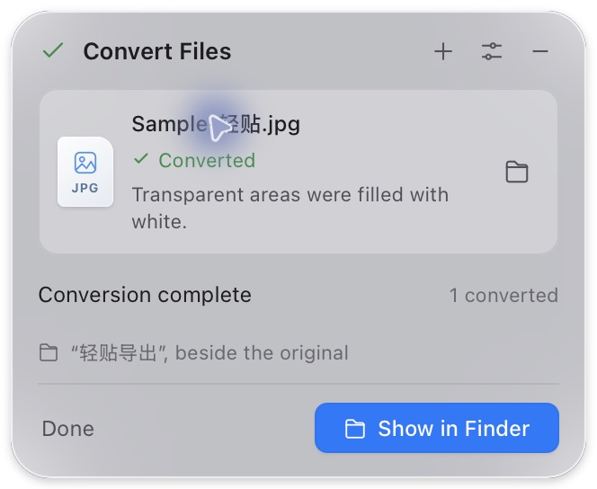
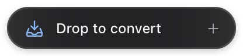
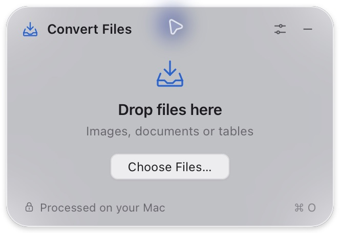

# NeatPaste

**Drop into the island. Pick a new format.** A small, local file converter for Mac.

[Download for Mac](https://github.com/gnpwvm28mg-eng/neatpaste/releases/latest) · [简体中文](README.zh-CN.md) · [Install](docs/INSTALL.md) · [Validation](docs/VALIDATION.md) · [Design](docs/DESIGN.md)



<details><summary>Compact mode and light appearance</summary>


</details>

Version 0.5.0 rests in a dark **196 × 36-point capsule** near the top of the screen. Drop files from Finder or the desktop, choose a format, and find the result next to the original in `轻贴导出`. Originals and existing exports are never overwritten.

This version follows [Apple’s AirDrop and material guidance](docs/REFERENCES.md), with system typography, blue action buttons and a format popup. The window adapts to its content: 332 × 228 points when empty, 332 × 272 with one file.

## Conversion matrix

| Input | Outputs | Scope |
| --- | --- | --- |
| PNG, JPG/JPEG, WebP, HEIC/HEIF, TIFF/TIF, BMP, GIF | PNG, JPG, HEIC, TIFF, BMP, GIF, PDF | Separate outputs; first frame only for animation or multiple images |
| TXT, Markdown, DOCX | TXT, MD, PDF, DOCX, RTF, HTML | Main-body text reflow |
| PDF | DOCX | Editable text with embedded pictures; complex pages may be kept as page images |
| PDF | TXT, MD, RTF, HTML | Existing text only; no layout reconstruction or OCR |
| PDF | PNG, JPG | **Page 1 only, at 144 dpi** |
| CSV, TSV, JSON | CSV, TSV, JSON | Rectangular text tables, including the first row and empty cells |

JSON tables are arrays of string rows, such as `[["name","code"],["Sam","00123"]]`. Objects, numeric cells, and ragged rows are rejected to avoid inferred types and precision loss. Formula-like strings in CSV/TSV are preserved and reported, since spreadsheet applications may interpret them as formulas.

When importing DOCX, only body text is extracted: headers, notes, pictures and table layout are excluded. Markdown markers stay literal. RTF and HTML are output formats, not inputs. WebP decoding is supported; encoding is not. GIF output is static with at most 256 colors. JPEG, HEIC, BMP and GIF fill transparency with white. TXT/MD/CSV/TSV require UTF-8 or BOM-tagged UTF-16; GBK is unsupported.

### PDF to Word with embedded pictures

Choose **Word (.docx)** for a PDF. The output contains its picture data inside the Word document, so images can display offline without the source PDF or external image links. Ordinary text remains editable and is reflowed with rendered image regions in approximate reading order. Images preserve their aspect ratio; source pages are separated.

Complex graphics, unsupported drawing constructs and scanned pages can be preserved as full-page images. Text in those page images, or overlapping a picture, is not separately editable. The app reports these cases. This is not OCR or exact reconstruction of complex columns and tables. PDFs with visible non-link annotations are rejected; flatten those annotations into the PDF first. Rendering limits keep memory and output size bounded; split unusually large PDFs if the app reports a limit.

## Use

1. Open the app; the capsule appears below the menu bar near the top center.
2. Drop files on it, or click it and choose **Choose Files…**.
3. Select a supported format, convert, and choose **Show in Finder**.
4. Collapse with the minus button or Escape. Drag the left tray icon to reposition it; Settings can return it to the top.

**Convert on drop** is optional and off by default. After choosing a format once, new files in that family can convert using the remembered format. Images, PDF, documents and tables are remembered separately. Invalid files and batches without a shared remembered format do not auto-start.

**⌘⇧Space** shows/hides the app. **⌘W** hides it; the menu bar reopens it. Quit from the menu bar. An active conversion queue finishes before quitting.

## Lightweight implementation

Tauri 2 and Rust use the system WebView. A Swift helper starts per conversion and exits afterward. No bundled browser, Office runtime, account, telemetry, conversion server, or folder scanner.

Limits: 10 sequential files, 50 MiB per image, 20 MiB per document/table, 40 megapixels, 200,000 UTF-16 text units, 100 PDF pages, and 50,000 table cells. DOCX expansion is limited to 40 MiB and 2,000 ZIP entries. Each helper job has a 120-second timeout. The output directory must be writable with space available.

See [validation](docs/VALIDATION.md) for current measurements and device-test boundaries. Earlier resource measurements do not establish v0.5.0 performance.

## Install and develop

[Download NeatPaste v0.5.0 for Mac](https://github.com/gnpwvm28mg-eng/neatpaste/releases/download/v0.5.0/NeatPaste-v0.5.0-macOS-arm64.zip). The app requires **Apple Silicon and macOS 13.3+**. Unzip and move the app to Applications. The local package is ad-hoc signed, without Developer ID signing or Apple notarization. Windows is deferred. Intel build support is provided, but not device-validated.

Development requires Node.js 22.12+, Rust 1.90+, and Xcode Command Line Tools.

```sh
npm ci
npm run tauri dev
```

`npm run dev` is a browser-only visual preview. Validate and package with:

```sh
npm test
npm run build:native
npm run test:native
cargo test --manifest-path src-tauri/Cargo.toml --locked
./scripts/package-macos.sh
```

Python 3 is used by source packaging, not by the installed app. ZIPs and checksums appear under `artifacts/`. Upload this folder with its dotfiles to GitHub; Actions validate code and build Apple Silicon / Intel artifacts without publishing a Release automatically.

[MIT](LICENSE) · [Contributing](CONTRIBUTING.md) · [Security](SECURITY.md)
