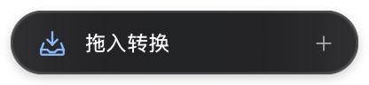
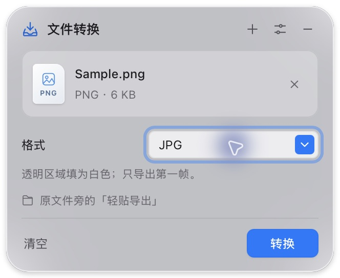
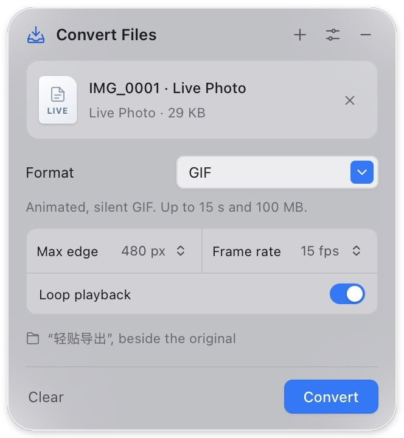

# 轻贴 · NeatPaste

**拖进灵动岛，换个格式。** 一个小巧、离线的 Mac 桌面文件转换工具。

[English](README.md) · [安装](docs/INSTALL.md) · [验证记录](docs/VALIDATION.md) · [设计](docs/DESIGN.md)



<details><summary>磨砂玻璃界面 / Frosted glass interface</summary>


</details>

v0.6.0 平时是一枚停在屏幕顶部的深色胶囊，实际图形约 **196 × 36 点**。直接从桌面或 Finder 拖入文件，展开后选择输出格式。结果存入原文件旁的「轻贴导出」，原件不动，重名自动编号。

这版参考苹果的 [AirDrop 与界面材质规范](docs/REFERENCES.md)，采用系统字体、蓝色操作按钮和格式下拉菜单。展开窗口随内容调整：空态 332 × 228 点，普通单文件 332 × 272 点，动画选项使用较高面板。

v0.6.0 新增 **MOV、MP4 转动态 GIF**，也可使用实况照片导出的配套 MOV。包含视频时会显示动画选项并调整面板高度。



这张原生应用截图使用合成照片与 MOV 配对，已验证文件选择器添加和动态转换；尚未完成真实 iPhone 实况照片导出的设备验证。

## 支持的格式

| 输入 | 可选输出 | 范围 |
| --- | --- | --- |
| PNG、JPG/JPEG、WebP、HEIC/HEIF、TIFF/TIF、BMP、GIF | PNG、JPG、HEIC、TIFF、BMP、GIF、PDF | 每个文件独立输出，动图和多图只取第一帧 |
| MOV、MP4 | 动态 GIF | 最大 100 MiB、15 秒；不含声音 |
| 导出的实况照片：HEIC/HEIF/JPG/JPEG + MOV | 动态 GIF | 同批添加配套文件，动态来自 MOV |
| TXT、Markdown、DOCX | TXT、MD、PDF、DOCX、RTF、HTML | 正文文字重新排版 |
| PDF | DOCX | 可编辑文字与内嵌图片；复杂页面可能保留为整页图片 |
| PDF | TXT、MD、RTF、HTML | 提取已有文字，不还原原版式，不含 OCR |
| PDF | PNG、JPG | **仅第一页，144 dpi**，后续页不导出 |
| CSV、TSV、JSON | CSV、TSV、JSON | 行列整齐的文本表格，保留首行与空单元格 |

JSON 表格采用二维**字符串**数组，例如 `[["姓名","编号"],["小明","00123"]]`；对象、数值或不齐整的行会被拒绝，避免擅自推断类型。CSV/TSV 保留原始文字，包括形似公式的单元格；此类值会提示可能被表格软件当作公式解释。

导入 DOCX 时仅提取正文，不保留页眉、脚注、图片、表格版式。Markdown 按原文保留标记。RTF 和 HTML 是文字导出格式，不是输入格式。WebP 当前只支持输入。**图片输入，包括已有 GIF，仍然只取第一帧**，输出 GIF 也是静态；视频使用独立的动态 GIF 转换路径。GIF 每帧最多 256 色。静态 JPG、HEIC、BMP、GIF 的透明部分铺白。TXT/MD/CSV/TSV 使用 UTF-8 或带 BOM 的 UTF-16，暂不支持 GBK。

### 动态 GIF 与实况照片

拖入本地 MOV 或 MP4，选择 GIF，可设置最长边 **320、480、640 像素**（默认 480）和 **10、15、20 帧/秒**（默认 15）。较小视频不会放大。默认无限循环，也可以关闭循环；尺寸、帧率和循环选项会保存在本机供下次沿用。GIF 没有声音；不同查看器的播放计时可能略有差异。文件超过 100 MiB 或时长超过 15 秒会报错，不会截取前 15 秒，请先剪短再转换。

实况照片请先在「照片」中选择 **文件 → 导出 → 导出未修改的原片**，得到照片和配套 MOV，再从 Finder 同时选中并拖入。**同一次添加、同目录、文件主名相同**的 HEIC、HEIF、JPG 或 JPEG 与 MOV，例如 `IMG_1234.HEIC` 和 `IMG_1234.MOV`，会合并为一项。这是按显式选中文件的名称配对，不验证 Apple 资产标识；应用不会在目录或照片图库中自动寻找配套视频。

只拖 HEIC 等照片仍按静态图片处理。直接从「照片」拖拽有时只会提供静态图，不能保证带上动态内容；也可单独拖入导出的 MOV。原照片与 MOV 均保留，GIF 使用视频中的动态，不复现「照片」中的实况特效。目前转换验证使用合成本地视频，尚未完成真实 iPhone 实况照片导出的设备验证。

### PDF 转 Word 保留图片

选择 **Word (.docx)** 后，图片会直接嵌入 Word 文件，离线打开也不依赖原 PDF 或外部图片链接。普通文字可以编辑，识别到的图片区域按阅读顺序与文字重排，保持图片比例并按原 PDF 页分隔。

复杂图形、暂不支持的绘图方式和扫描页可能以整页图片保留；其中的文字，以及叠在图片上的文字，无法单独编辑，转换结果会说明。这不等于 OCR 或完全还原复杂多栏、表格版式。包含可见非链接批注的 PDF 会提示暂不支持，请先将批注合并到 PDF 页面。图片处理设有总量和体积上限，超限时请拆分 PDF。

## 使用

1. 打开应用，胶囊出现在屏幕顶部，菜单栏下方。
2. 把文件拖到胶囊上，松手后选择可用格式。也可点击胶囊，再点「选择文件…」。
3. 在下拉菜单选择格式并点「转换」，完成后点「在 Finder 中显示」。
4. 点击收起按钮或按 Esc 回到胶囊。拖动左侧投递图标调整位置；设置可让它回到屏幕顶部。

在设置开启 **「拖入即转换」** 后，同类文件会使用上次成功发起转换时选择的格式；第一次仍需选择。图片、PDF、文档、表格、动态文件分别记忆，动态转换还会沿用本机保存的 GIF 选项。存在不支持文件或没有共同格式时不会自动开始。默认关闭。

全局快捷键为 **⌘⇧Space**。按 ⌘W 隐藏应用，菜单栏可重新唤起，菜单栏「退出」完全退出。转换期间退出会等待当前队列完成。窗口收起不会丢掉本次文件列表。

## 轻量与限制

- Tauri 2 + Rust，使用 macOS 系统 WebView，不内置浏览器或 Office 运行时。
- 原生 Swift 转换助手按需启动，用完退出；视频使用系统 AVFoundation，GIF 使用 ImageIO，均离线处理，不内置大型视频运行时；无账号、埋点、网络上传或目录扫描。
- 最多 10 个队列项，逐个转换，配对实况照片算一项；图片 50 MiB，视频 100 MiB 且不超过 15 秒，文档/表格 20 MiB，图片输入 4,000 万像素。
- 视频至少 0.04 秒，源视频帧不超过 4,000 万像素；动态 GIF 最多 300 帧、累计 1.25 亿帧像素、50 MiB 输出。
- 文字最多 200,000 个 UTF-16 单元，PDF 最多 100 页，表格最多 50,000 单元格；DOCX 解压后最多 40 MiB / 2,000 条目。
- 每个转换助手最多运行 120 秒。导出目录需有写入权限及剩余空间；媒体需系统解码器支持，损坏或不支持的文件会报错。

当前实测与限制见[验证记录](docs/VALIDATION.md)。不把旧版内存数据用于 v0.6.0。

## 安装与源码

[下载 NeatPaste v0.6.0 Mac 版](https://github.com/gnpwvm28mg-eng/neatpaste/releases/download/v0.6.0/NeatPaste-v0.6.0-macOS-arm64.zip)，适用于 **M 系列芯片、macOS 13.3+**。解压，把 `NeatPaste.app` 放入「应用程序」。应用经过本地 ad-hoc 签名，尚无 Developer ID 签名或 Apple 公证。Windows 后续再做；Intel 提供构建工作流，但未实机验证。

开发需 Node.js 22.12+、Rust 1.90+、Xcode Command Line Tools。项目可直接上传 GitHub，保留 `.github` 等隐藏文件。

```sh
npm ci
npm run tauri dev
```

浏览器仅预览界面：`npm run dev`。验证和打包：

```sh
npm test
npm run build:native
npm run test:native
cargo test --manifest-path src-tauri/Cargo.toml --locked
./scripts/package-macos.sh
```

源码打包需要 Python 3，安装后的应用不需要。ZIP 与校验值输出到 `artifacts/`。GitHub Actions 提供验证及 Apple Silicon / Intel 构建，不会自动发布 Release。

[MIT](LICENSE) · [参与开发](CONTRIBUTING.md) · [安全说明](SECURITY.md)
